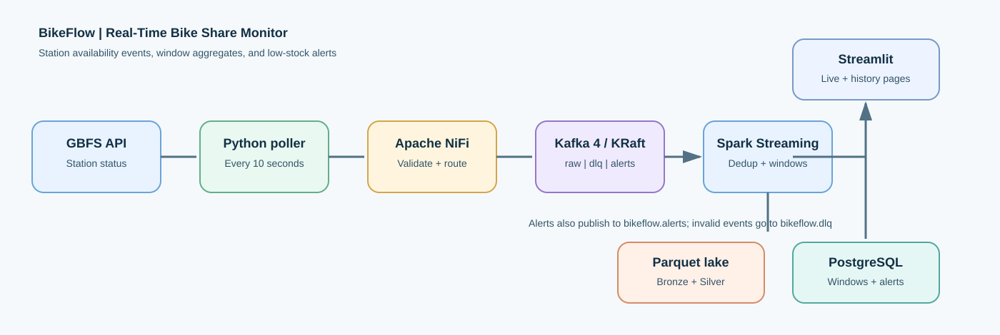

# BikeFlow — Real-Time Bike Share Monitor

DEPI individual streaming project. BikeFlow polls the public Citi Bike GBFS station-status feed, sends station snapshots through Apache NiFi and Kafka, processes them with Spark Structured Streaming, serves window aggregates and alerts from PostgreSQL, and displays live and historical views in Streamlit.

## Architecture

## Start

Prerequisites: Docker Desktop with at least 8 GB RAM available. Copy `.env.example` to `.env` and change the local database and NiFi passwords. Then run `docker compose up --build`. Streamlit is at http://localhost:8501, NiFi at https://localhost:8082/nifi, Kafka's host listener is `localhost:29092`, and PostgreSQL is at `localhost:5433`. The example NiFi login is `bikeflow` with the local password set in `.env`.

The initial schema, named volumes, KRaft broker, and explicit topic creation are included. Raw events are retained for 72 hours to bound local disk use; DLQ and alerts are retained for seven days. The raw topic has three partitions, keyed by `station_id` so a station's updates remain ordered within a partition.

## Important first-run step

NiFi flows contain version-specific component metadata and must be exported from the target NiFi version. Follow [the NiFi setup](nifi/README.md), start the flow, and save its export as `nifi/flow.json`. Until this is done the incoming event endpoint is not active, so the poller will log connection failures and downstream tables will remain empty. The assignment also requires screenshots and a LinkedIn post; these need to be captured/written by you after the stack runs.

## Data and processing choices

- **Source:** Citi Bike GBFS station status. Polling interval is 60 seconds by default; adjust it in `.env` to be considerate of the public endpoint.
- **Event identity:** deterministic UUID from station, feed report time, and bike count. This lets Spark deduplicate replayed snapshots after a restart.
- **Window:** one-minute, sliding every 30 seconds, grouped by station, with a ten-minute event-time watermark.
- **Alert:** a station snapshot with one or zero available bikes is sent to the alerts topic and PostgreSQL.
- **PostgreSQL idempotency:** aggregate writes use `ON CONFLICT` on the window/station primary key; alert writes use the deterministic alert ID and `ON CONFLICT DO NOTHING`.
- **Checkpoints:** each Spark query uses an independent Docker volume checkpoint path.

## Screenshots and submission

Save the required full-screen screenshots under `screenshots/` after validating the pipeline: NiFi canvas/provenance, Kafka topics and consumers, Spark streaming UI, bronze/silver partitions, PostgreSQL query results, restart resilience, running containers, and both dashboard pages. A LinkedIn post draft is in `LINKEDIN_DRAFT.md`; replace the repository and image placeholders, then publish it yourself.

## Repository contents

`docker-compose.yaml`, `kafka/`, `nifi/`, `spark/`, `postgres/`, `dashboard/`, `replayer/`, and `.env.example` hold the project files. Never commit `.env` or credentials.
